<div align="center">

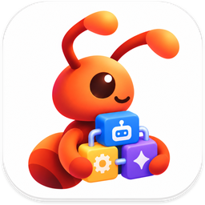

# Antumi (安图米)

**把活交给 AI Agent，进度和结果你都看得到。**

本地优先的 AI 编程工作台。一块看板管理 Claude Code、Codex 和 Cursor：<br/>
每个任务在独立的 Git worktree 里跑，先确认计划，再执行，最后由你验收。

[](CHANGELOG.md)
[](LICENSE)


[快速开始](#快速开始) · [功能](#功能) · [支持的 Agent](#支持的-agent) · [技术架构](docs/ARCHITECTURE.md) · [更新日志](CHANGELOG.md)

</div>

<p align="center">
  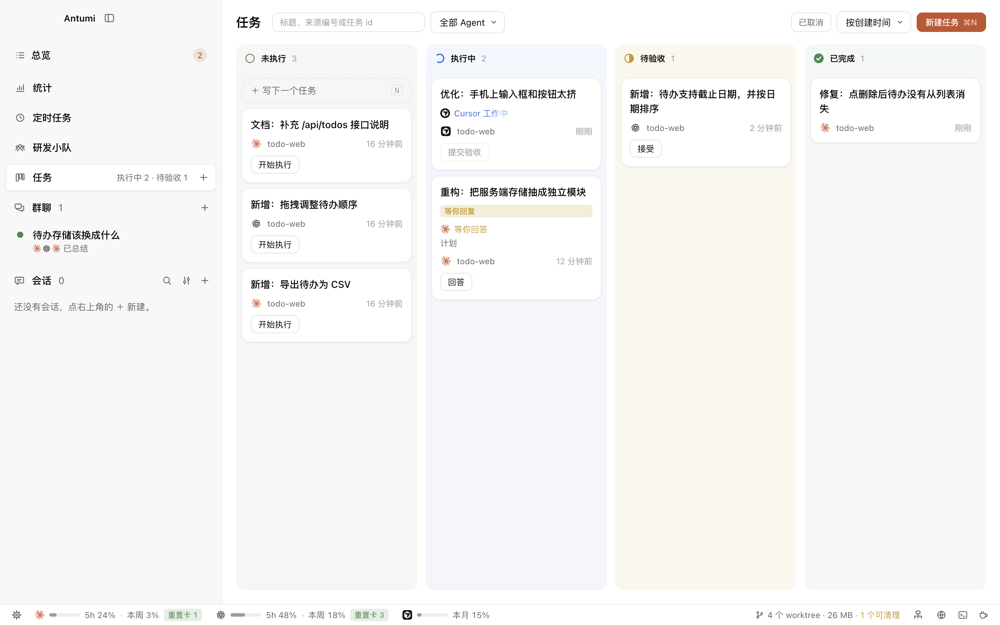
</p>

---

## 为什么需要 Antumi (安图米)

你开着三个终端：Claude Code 在修 bug，Codex 在写导出，第三个窗口你已经忘了它在干嘛。哪个在等你批准？哪两个改到了同一个文件？想换个 Agent 接手，又得把需求和踩过的坑从头讲一遍。

Agent 加得越多，你越像在值班盯监控。

Antumi 把这些收进一块看板。每件事是一张卡片，交给一个 Agent，在自己的 worktree 和分支里执行，互不干扰。Agent 在做什么、是不是在等你、改了哪些文件，打开就能看到。做完了由你验收：接受、接着改，或者带上失败原因重做。

| | 在终端里直接跑 Agent | 用 Antumi |
|---|---|---|
| 同时推进几件事 | 一排标签页，挨个切过去看 | 一块看板，卡片上写着谁在做什么、是否在等你 |
| 改动互相踩 | 几个 Agent 共用一个 checkout | 每个任务一个 worktree、一条分支 |
| 关窗口、重启 | 进程跟着结束 | daemon 托管所有 Agent，关窗口不中断 |
| 换一个 Agent | 重新讲一遍需求 | 一键移交，新 Agent 拿到聊天记录和你的补充说明 |
| Agent 说"做完了" | 自己 `git diff` 翻 | 检查器列出每个提交、每个文件的 diff |
| Agent 在等你批准 | 切回终端才发现 | 系统通知、Dock 角标、屏幕顶部弹卡片直接回答 |

---

## 快速开始

**前提**：至少装好并登录一个 Agent CLI（Claude Code、Codex 或 Cursor）。Antumi 不自带模型，驱动的是你已经在用的 CLI。

### 从源码运行

需要 Node ≥ 22.13 和 pnpm 12。

```bash
git clone https://github.com/flyhero/antumi.git
cd antumi
pnpm install
pnpm dev          # 同时启动 daemon、core 和桌面端
```

### 打包成 macOS 应用

```bash
pnpm dist:mac     # 产物在 packages/desktop/dist/Antumi-<版本>-arm64.dmg
```

装了 App 的机器不需要 Node 和 pnpm。产物没有签名，拷到别的机器上首次要右键「打开」。

### 第一个任务

1. **检查环境**：启动后打开 设置 → 智能体，确认 Agent 显示「已登录」。缺什么，这里给出可以直接复制的安装或登录命令。
2. **记下任务**：在「任务」看板上按 <kbd>N</kbd>，写标题，选项目和 Agent。详情可以不写。
3. **开始并验收**：点「开始」，Agent 在独立 worktree 里先出计划，你确认后它开始改代码。做完点「提交验收」，在检查器里看 diff，然后接受、接着改或重做。

<p align="center">
  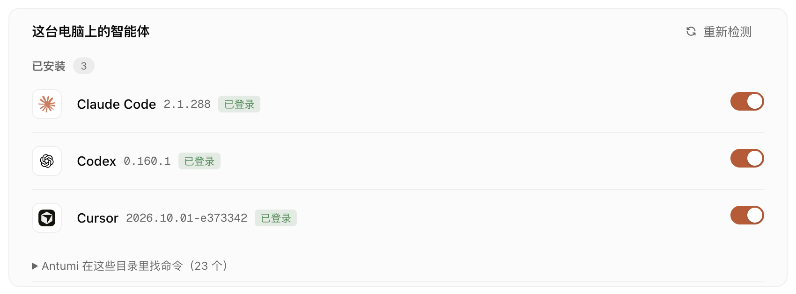
</p>

---

## 它怎么工作

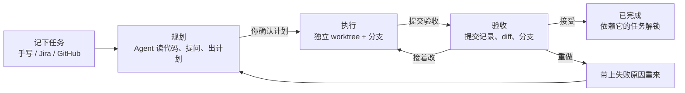

---

## 功能

读写代码、跑命令、计划模式这些，Claude Code 和 Codex 自己就会。下面是 Antumi 在它们之上多出来的。

<table>
<tr>
<td width="42%" valign="middle">

### 总览：等你的事在最上面

等你确认的、等你回答的、待验收的汇在一处，旁边是谁在跑、接下来几点有定时任务。看板上每张卡片都写着 Agent 正在做什么，以及你下一步该点什么：开始、回答、提交验收、接受。

</td>
<td width="58%">
  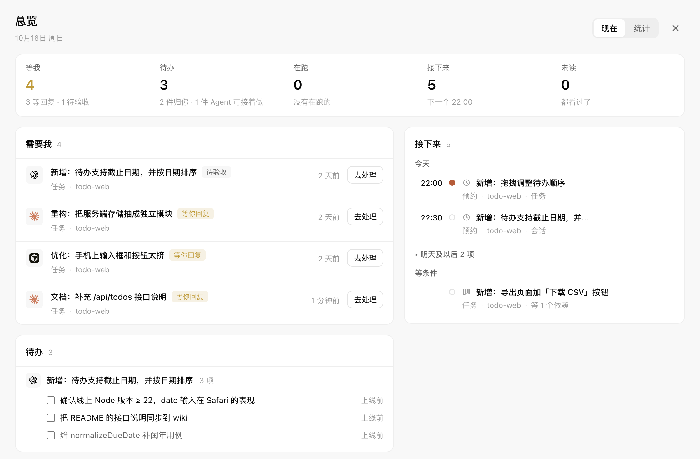
</td>
</tr>
<tr>
<td width="42%" valign="middle">

### 先问清楚、先出计划，再动手

开始任务时 Agent 只读代码，有疑问先用选项问你，然后给出计划。计划在右侧完整展示，你在对话里一键执行、继续规划或停下；也可以预约到夜里再批准，或者交给研发小队执行。

</td>
<td width="58%">
  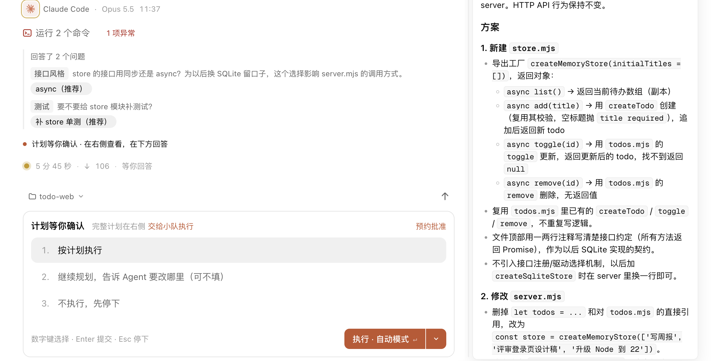
</td>
</tr>
<tr>
<td width="42%" valign="middle">

### 验收不用翻终端

检查器列出从分支起点算起的每个提交、每个文件的增删和 diff。分支、Fetch / Pull / Push / Commit、合并和冲突处理都在这里。提交信息可以留空，由小模型按项目的提交规范写好。重做时这次的改动另存到 `-tryN` 分支，任务分支从头再来。

</td>
<td width="58%">
  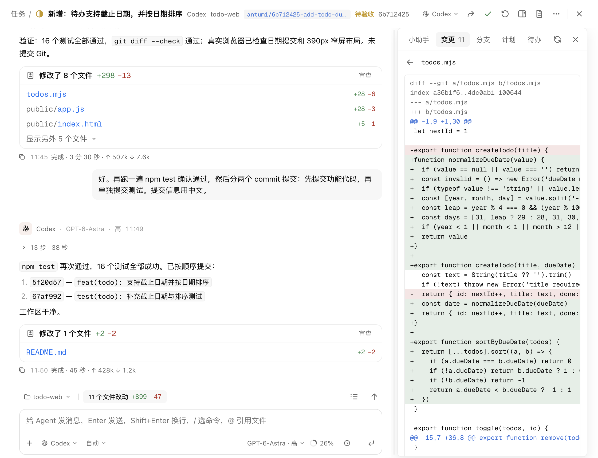
</td>
</tr>
<tr>
<td width="42%" valign="middle">

### 聊天中途移交

Claude Code 额度用完了，或者想让 Codex 换个思路？在输入框里选另一个 Agent，发送键就变成「移交」。新 Agent 拿到可见的聊天记录和你的补充说明，在同一个 worktree 里接着做；切回原来的 Agent 时，它的原生会话会被恢复。

</td>
<td width="58%">
  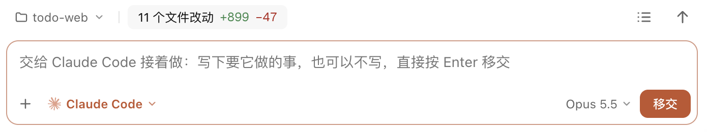
</td>
</tr>
<tr>
<td width="42%" valign="middle">

### 不在 Antumi 里也能回答

Agent 等你批准、回答或审计划时，屏幕顶部弹出卡片，直接在上面选，不用切回窗口。配合系统通知和 Dock 角标，不会再让 Agent 干等半小时。

</td>
<td width="58%">
  <p align="center">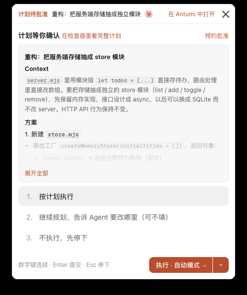</p>
</td>
</tr>
<tr>
<td width="42%" valign="middle">

### 群聊：让几个 Agent 先吵一架

2–5 个 Agent 和模型围绕同一个问题分轮讨论，每位可以设立场，可以匿名互评。第一轮各自独立作答，之后每轮只看别人的新发言，最后由主持人总结。可以 @ 某个成员单独问，中途加人、换议题；总结和任一条回答都能直接转成任务。成员只读，不改代码。

</td>
<td width="58%">
  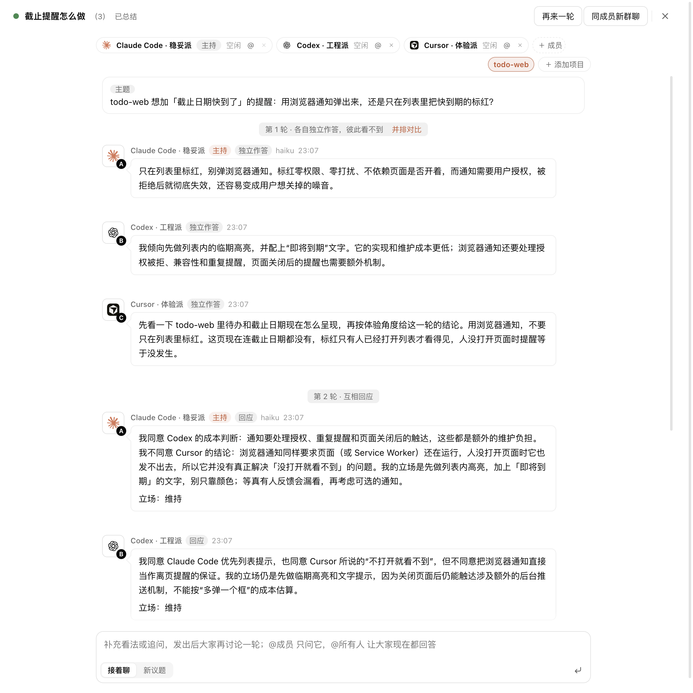
</td>
</tr>
<tr>
<td width="42%" valign="middle">

### 内置浏览器：Agent 自己验证页面

Agent 打开页面、点击输入、切手机尺寸、截图、看控制台报错，验证自己写的前端；你可以随时接管。每个会话有自己的标签页，窗口关了页面也还在。

</td>
<td width="58%">
  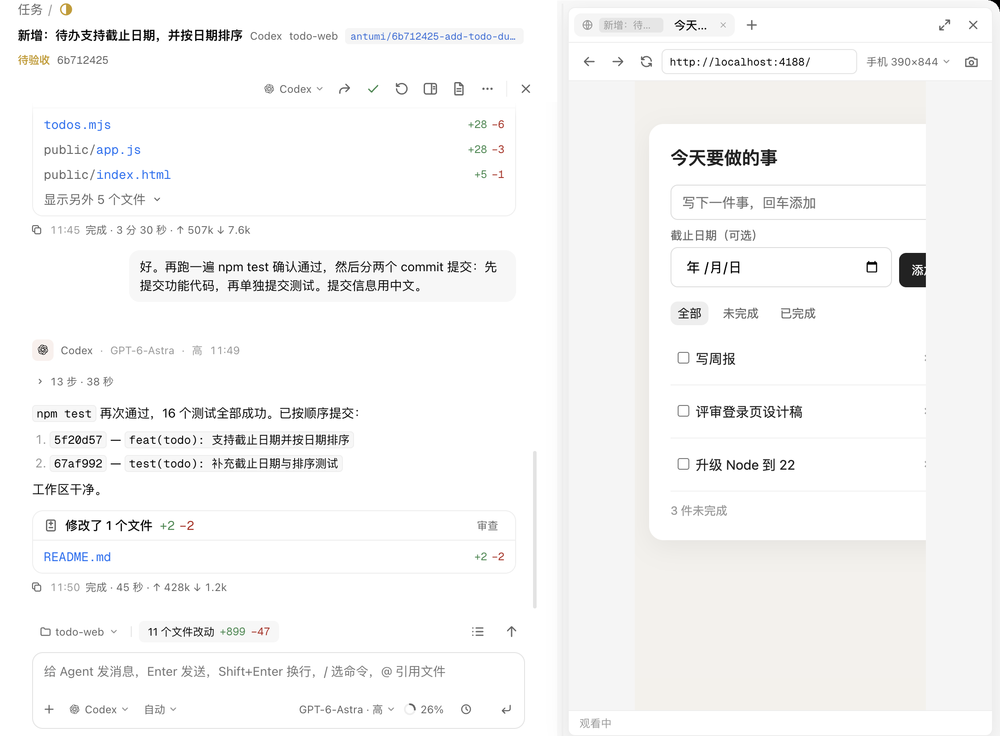
</td>
</tr>
<tr>
<td width="42%" valign="middle">

### 定时任务与预约

每天、工作日、每周定点开一个会话，让 Agent 无人值守地做完：代码审查、依赖检查、周报，内置八个模板。任务、计划批准和聊天消息也都能预约到指定时间。撞到用量上限时自动约好恢复时间，到点替你继续。

</td>
<td width="58%">
  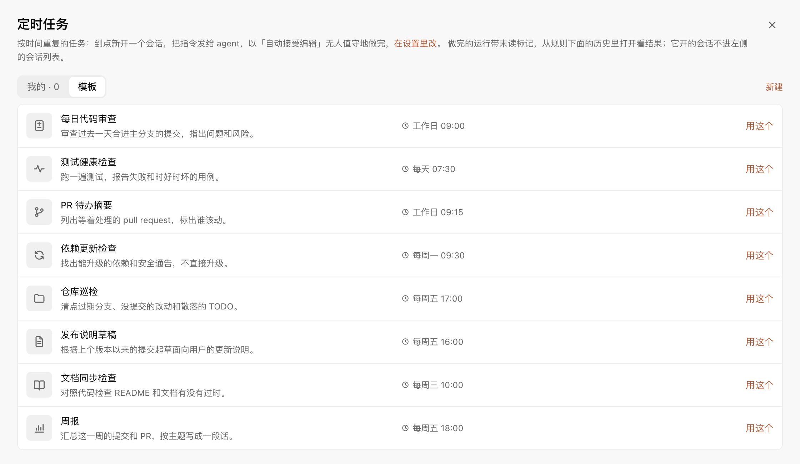
</td>
</tr>
</table>

### 研发小队

配好队长和成员各用哪个 Agent、模型和角色，把任务交给小队。队长先只读地看代码，和你商量出计划和分工，你确认后再派活：开发串行、只读分析并行，大家共用任务的 worktree。

<p align="center">
  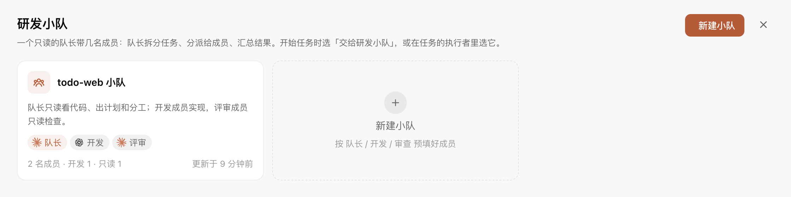
</p>

### 任务来源接入

Jira、GitHub 的 issue 和 PR 定时同步进收件箱，可以导入成任务，也可以先开会话只读排查，确认方案后再修。原文作为不可信资料隔离，里面的指令不会被当成你的要求。来源是插件，可以从本地目录、ZIP 或 GitHub Release 安装新的。

### 省钱小妙招

- **轻活交给小模型**：翻译、提交信息、会话标题和划词「小助手」用每个 Agent 最便宜的模型，不读主会话上下文。总览的「统计」按 API 标价算出花了多少、比交给主模型省了多少。
- **额度看得见**：状态栏和选 Agent 的地方直接显示每个 Agent 的剩余额度，例如「5h 32% · 本周 4%」。一个用完了，Antumi 建议换还有额度的那个，或一键移交。
- **不浪费等待**：定时任务的 Agent 可以选「自动」，到点挑有额度的跑；额度用完的会话到恢复时间自动续上。

<p align="center">
  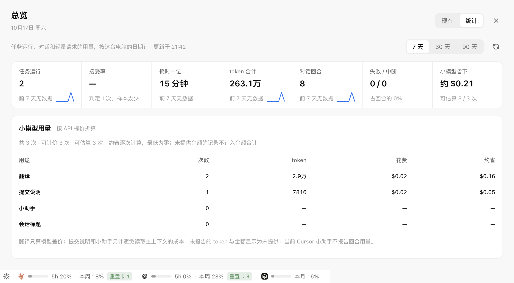
</p>

<details>
<summary><b>还有这些</b></summary>

<br/>

- **待办**：Agent 回复里提到要你之后处理的事会记成待办，标明「需要你」还是「Agent 可做」。换轮、重启、移交都还在，总览里可以勾掉或一键交回给 Agent。
- **多项目任务**：一个任务跨前后端多个仓库，每个仓库各建一个 worktree，分支同名。
- **任务依赖**：前置任务验收通过才放行，新分支直接叠在前置任务的分支上；没放行前也能先规划。
- **分支视图**：检查器里看任务分支从哪里长出来、有几个提交，右键复制 SHA、建分支、打标签或比较。
- **Worktree 清理**：按「能不能清理」分组，删前逐个复查，从不 `--force`，有未提交改动或独有提交的一律保留。
- **终端与端口面板**：shell 由 daemon 托管，关窗口不断；列出每个任务、会话在监听的端口，一键在内置浏览器里打开。
- **Agent 能翻你的记录**：通过 Antumi 的 MCP 读最近的会话、任务和群聊，不管是哪个 Agent 做的，适合「总结我本周的工作」。
- **并发上限**：限制同时运行的 Agent 总数和每款 Agent 的数量，超出的排队。
- **知识库、技能库、MCP**：接入 Obsidian 库作为资料，安装和更新 Agent Skills，统一管理你的 MCP 服务器。

<p align="center">
  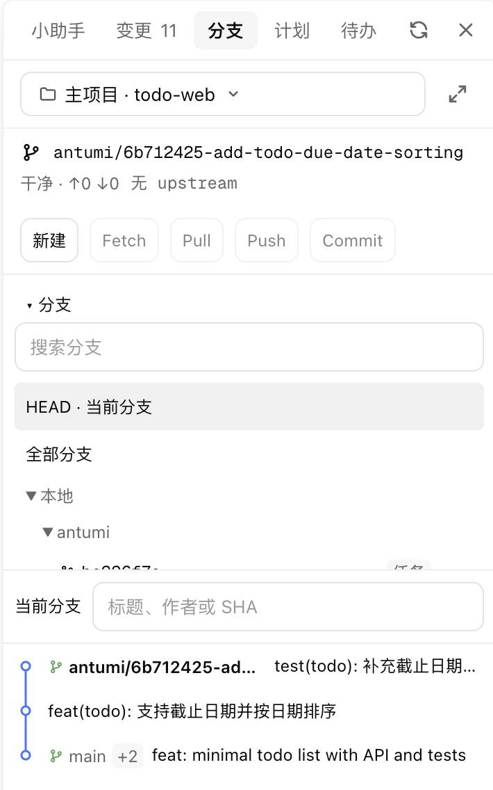
  &nbsp;&nbsp;
  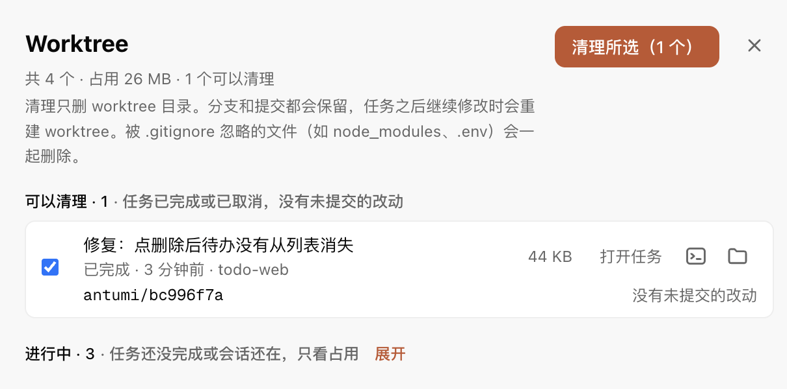
</p>

</details>

---

## 支持的 Agent

Antumi 不自带模型，驱动的是你已经装好、登录好的 Agent CLI。

| Agent | 接入方式 | 权限模式 | 计划审批 | 移交 | 定时任务 / 预约 |
|---|---|---|:-:|:-:|:-:|
| **Claude Code** | `claude -p`（stream-json） | 逐项确认 · 自动接受编辑 · 规划 · 自动判断 | ✓ | ✓ | ✓ |
| **Codex** | `codex app-server` | 逐项确认 · 自动 · 规划 · 只读 | ✓ | ✓ | ✓ |
| **Cursor** | `cursor-agent acp` | Agent · Plan · Ask | ✓ | ✓ | — |

「全部放行」不会默认选中。设置 → 智能体 还会列出 Antumi 认识、但尚未接入的 Agent CLI。

### 常用快捷键

| 按键 | 作用 |
|---|---|
| <kbd>N</kbd>（看板上） | 在「未执行」列顶部快速记一个任务 |
| <kbd>⌘</kbd> <kbd>N</kbd> | 打开完整的新建任务对话框 |
| <kbd>Ctrl</kbd> <kbd>`</kbd> | 打开 / 关闭终端面板 |
| <kbd>Ctrl</kbd> <kbd>Shift</kbd> <kbd>`</kbd> | 打开 / 关闭浏览器面板 |
| <kbd>⌘</kbd> <kbd>,</kbd> | 设置 |
| <kbd>⌘</kbd> <kbd>F</kbd> | 搜索当前聊天 |
| <kbd>Enter</kbd> / <kbd>Shift</kbd> <kbd>Enter</kbd> | 发送 / 换行；Agent 忙时 Enter 会把消息排队 |
| <kbd>Tab</kbd> 或 <kbd>→</kbd> | 采用 Claude Code 预测的下一句 |
| <kbd>Esc</kbd> | 中断当前回合；在任务页里回到看板 |

---

## 本地优先，成果优先

- **数据在你的机器上**：任务、会话和 worktree 都在 `~/.antumi/`，核心功能不依赖任何 Antumi 托管服务。
- **只对本机开放**：core 只监听 `127.0.0.1`，并且每个连接都要带 token。
- **不经过 shell**：Agent 命令以参数数组启动，prompt 前加 `--`。
- **凭据不外泄**：Jira / GitHub 凭据单独存放（权限 600），不返回给界面，也不交给 Agent。
- **外部内容当作不可信**：导入的 issue 原文包在 `<untrusted-source>` 里交给 Agent；任务图片保存前去掉 EXIF。
- **不替你删成果**：worktree 只在你确认后清理，删前重新检查，有未提交改动或独有提交的一律保留。

---

## 文档

| 我想…… | 看这里 |
|---|---|
| 了解整体架构、进程边界和通信协议 | [技术架构 · 总体架构](docs/ARCHITECTURE.md#1-总体架构) |
| 弄清任务怎么流转、规划、验收、处理依赖 | [技术架构 · 任务模型](docs/ARCHITECTURE.md#2-任务模型) |
| 管理 worktree、分支、合并冲突 | [技术架构 · Worktree 与 Git](docs/ARCHITECTURE.md#3-worktree-与-git) |
| 了解各 Agent 怎么接入、权限模式对应什么 | [技术架构 · Agent 接入与聊天](docs/ARCHITECTURE.md#4-agent-接入与聊天) |
| 让 Agent 用浏览器验证页面 | [技术架构 · 内置浏览器](docs/ARCHITECTURE.md#5-内置浏览器) |
| 写一个任务来源插件 | [插件](docs/PLUGINS.md) |
| 打包、安装、卸载 | [技术架构 · 打包与安装](docs/ARCHITECTURE.md#8-打包与安装) |
| 参与开发 | [开发与验证](docs/ARCHITECTURE.md#9-开发与验证) · [AGENTS.md](AGENTS.md) · [DESIGN.md](DESIGN.md) |
| 看每个版本改了什么 | [CHANGELOG.md](CHANGELOG.md) |

---

## 现状

Antumi 目前是**开发者预览版**（0.18.x），主要在 macOS 上开发和测试，需要从源码运行或自行打包。接下来的重点是验收闭环：按项目配置的测试命令在 worktree 里跑，把结果作为验收证据放进检查器，再到 PR 和合并。

欢迎提 [issue](https://github.com/flyhero/antumi/issues)：用下来哪里别扭、想接哪个 Agent，都可以说。

## 关于名字

**Antumi（安图米）是一个受 ant（蚂蚁）启发的自造词。** 单只蚂蚁很小，合力却能完成大活。Antumi 把不同的 AI 编程 Agent 集中到同一个工作台，让任务分头推进，进度和成果都看得清楚。

吉祥物是一只叫「蚁米」的小蚂蚁。

## 许可

[Apache License 2.0](LICENSE)
