<div align="center">


# Antumi（安图米）

**一个工作台，和多个 AI Agent 一起工作。**

本地优先的多 Agent 工作台，统一管理 Claude Code、Codex 和 Cursor 的会话、任务、群聊与定时运行。

[](CHANGELOG.md)
[](LICENSE)


[功能导览](#功能导览) · [支持的 Agent](#支持的-agent) · [快速开始](#快速开始) · [文档](#文档) · [更新日志](CHANGELOG.md) · [反馈](https://github.com/flyhero/antumi/issues)

**简体中文** · [English](README.en.md)

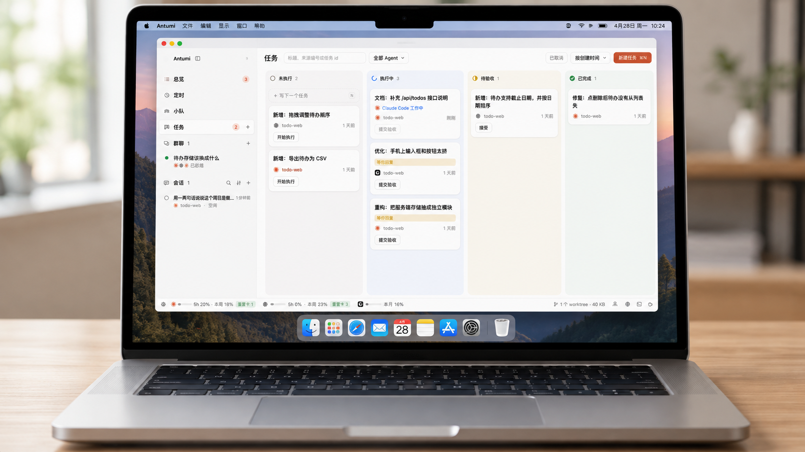

</div>

## 为什么是 Antumi（安图米）

同时使用 Claude Code、Codex、Cursor 等多个 Agent 时，你可能遇到过这些问题：

- 会话开得多，记不清哪个在做什么、哪个在等你批准。
- 想换个 Agent 接手，又得把需求从头讲一遍。
- 来回切窗口、查进度，花在管理 Agent 上的时间越来越多。
- 哪个Agent额度快过期、哪个要重置，浪费了机会。

Antumi 把 Claude Code、Codex 和 Cursor 放进同一个本地工作台：直接开会话处理问题，让多个 Agent 在群聊里讨论方案，或安排它们定时运行。谁在工作、谁在等你、接下来要做什么，都能在总览里看到。

需要按计划推进、隔离代码并验收的工作，可以放进任务看板：执行时使用独立 worktree，支持任务依赖，也能交给研发小队协作完成。会话和任务都支持中途换 Agent，聊天记录和你的补充说明会一起交给新 Agent。

- 🪟 **会话集中管理**：统一查看进度和待处理请求，两个会话可以并排打开。
- 💬 **多个 Agent 一起讨论**：群聊中比较方案，由主持人汇总结论。
- 🗂️ **任务有计划、有验收**：在独立 worktree 里执行，也能交给研发小队协作。
- 🔁 **随时移交**：换 Agent 时带上可见的聊天记录和补充说明。
- ⏰ **定时运行**：让 Agent 按时做代码审查、依赖检查或周报。
- 🔒 **本地优先**：记录保存在本机，Agent 由后台进程托管，关窗口不中断。

## 功能导览

Antumi 统一管理多个 Agent 的会话、协作、执行和结果。下面按使用场景介绍。

### 总览：等你的事排在最前面

等你确认的、等你回答的、待验收的汇在一处，下面是 Agent 记下的待办，右边是接下来几点要跑的预约和定时任务、还在等依赖的任务。点「去处理」直接跳到那一步。


### 会话：直接对话，随时移交

选好 Agent 和项目就能开始对话；也可以不选项目，使用独立的工作目录。两个普通会话可以并排打开，各自输入、查看进度和处理批准请求。

Claude Code 额度用完了，或者想让 Codex 换个思路？在输入框里选另一个 Agent，发送键就变成「移交」。新 Agent 拿到可见的聊天记录和你的补充说明，沿用当前工作目录；任务会话仍在原来的 worktree 里继续。切回原来的 Agent 时，会恢复它的原生会话，并补上离开期间的记录。


### 群聊：让几个 Agent 先吵一架

2–5 个 Agent 和模型围绕同一个问题分轮讨论，每位可以设立场，可以匿名互评。第一轮各自独立作答，之后每轮只看别人的新发言，最后由主持人总结。可以 @ 某个成员单独问，中途加人、换议题；总结和任一条回答都能直接转成任务。成员只读，不改代码。


### 定时与预约

按每天、工作日或每周的时间安排，让 Claude Code 或 Codex 自动开启会话，执行代码审查、依赖检查、周报等工作，内置八个模板。任务、计划批准和聊天消息也能预约到指定时间，在同一页的「预约」里管理。Cursor 暂不支持定时和预约运行。


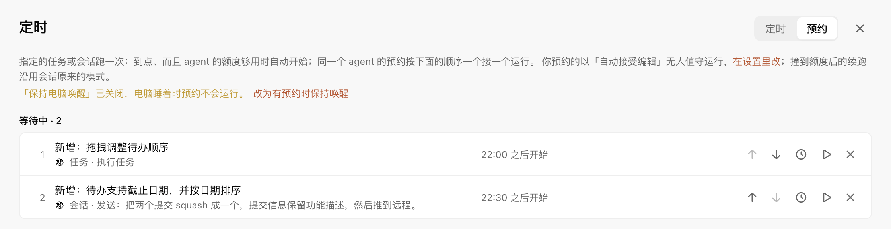

### 研发小队

配好队长和成员各用哪个 Agent、模型和角色，把任务交给小队。队长先只读地看代码，和你商量出计划和分工，你确认后再派活：开发串行、只读分析并行，大家共用任务的 worktree。


### 验收是一道关，不是看一眼 diff

Agent 说「做完了」之后发生什么，Antumi 替你定好了。项目配了检查命令（比如 `npm test`）的话，「提交验收」会先在 worktree 里跑一遍，没过就不进待验收，结果直接交回 Agent 修。

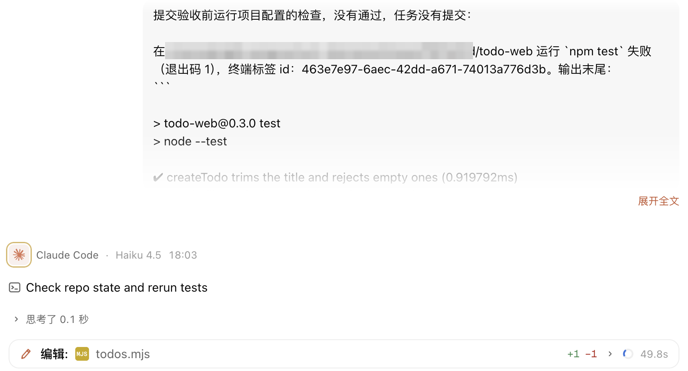

待验收的任务由你三选一：**接受**，进已完成，依赖它的任务这时才解锁；**接着改**，在聊天里写哪里不对，Agent 接着原来的会话改；**重做**，这次的改动另存到 `-tryN` 分支，任务分支从起点重来，Agent 会被告知重做原因。


验的是整条分支：检查器按分支起点列出每个提交、每个文件的增删和 diff，Agent 跑了几轮、提交了几次都汇在一处。Fetch / Pull / Push / Commit、合并和冲突处理也在这里，提交信息留空由小模型按项目规范写。小队任务暂不运行提交前检查。

### 顺手改两行，不用切到 IDE

检查器的「文件」页是一个编辑器：项目文件树可筛选，<kbd>?</kbd> 搜索整个项目，<kbd>⌘</kbd> <kbd>S</kbd> 保存。Agent 在你编辑时改了同一个文件，会问你重新加载还是保留，不会悄悄丢掉任何一边。想换个编辑器，一键用 VS Code 等本机应用打开。

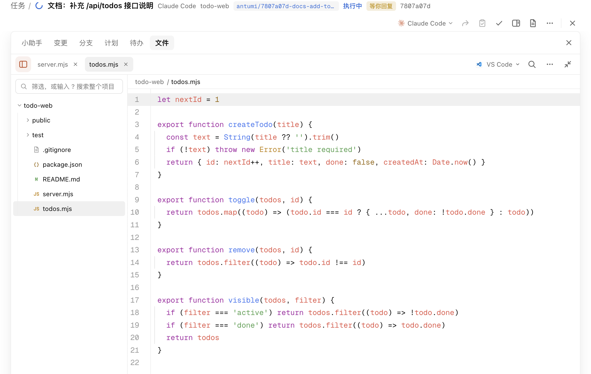

### 不在 Antumi 里也能回答

Agent 等你批准、回答或审计划时，屏幕顶部弹出卡片，直接在上面选，不用切回窗口。系统通知和 Dock 角标也会提示待处理的请求。

<p align="center">
  
</p>

### 内置浏览器：Agent 自己验证页面

Agent 打开页面、点击输入、切手机尺寸、截图、看控制台报错，验证自己写的前端；你可以随时接管。每个会话有自己的标签页，窗口关了页面也还在。


### 用量与轻量任务

- **轻活交给小模型**：翻译、提交信息、会话标题和划词「小助手」默认使用轻量模型，也可以自行指定，不读主会话上下文。总览的「统计」按 API 标价估算花费和节省金额，不代表订阅账号的实际扣款。
- **额度看得见**：状态栏和 Agent 选择器集中显示 Claude Code、Codex 和 Cursor 的用量与恢复时间，支持切换已用或剩余比例；Cursor 显示月度用量。可用的重置卡和全员重置预告也会显示。
- **不浪费等待**：Claude Code、Codex 撞到用量上限时自动约好恢复时间，到点替你发一条继续。定时任务的 Agent 可以选「自动」，到点挑有额度的跑。

<table>
<tr>
<td width="62%" valign="top">
  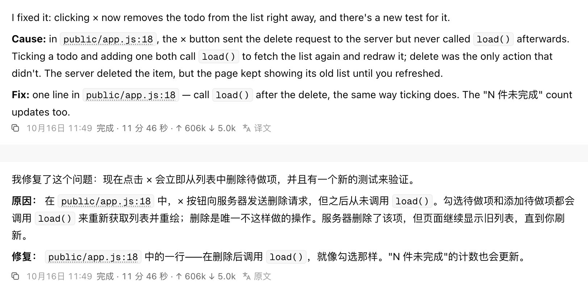<br/>
  <sub>翻译：Agent 用英文回复，点一下就是中文，随时切回原文</sub>
</td>
<td width="38%" valign="top">
  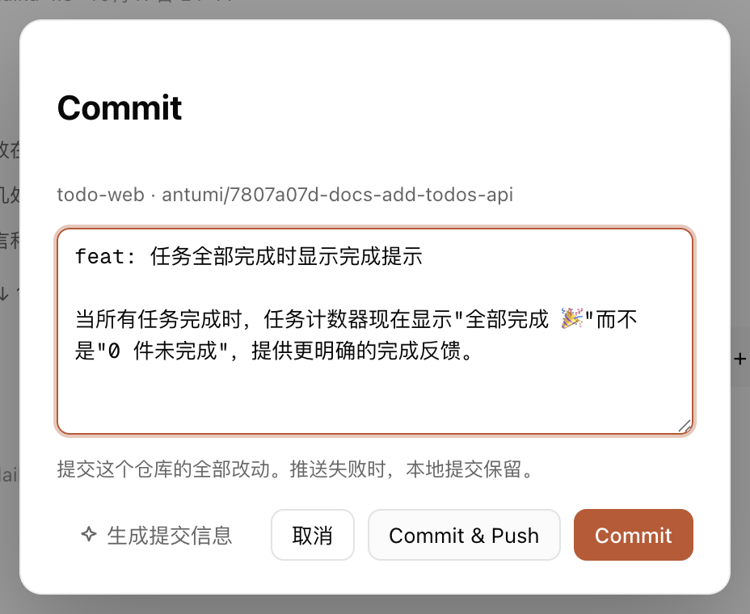<br/>
  <sub>提交信息：留空点「生成」，小模型按改动写好，你看一眼再提交</sub>
</td>
</tr>
</table>


### 任务来源接入

Jira、GitHub 的 issue 和 PR 定时同步进收件箱，可以导入成任务，也可以先开会话只读排查，确认方案后再修。原文作为不可信资料隔离，里面的指令不会被当成你的要求。来源是插件，可以从本地目录、ZIP 或 GitHub Release 安装新的。

<p align="center">
  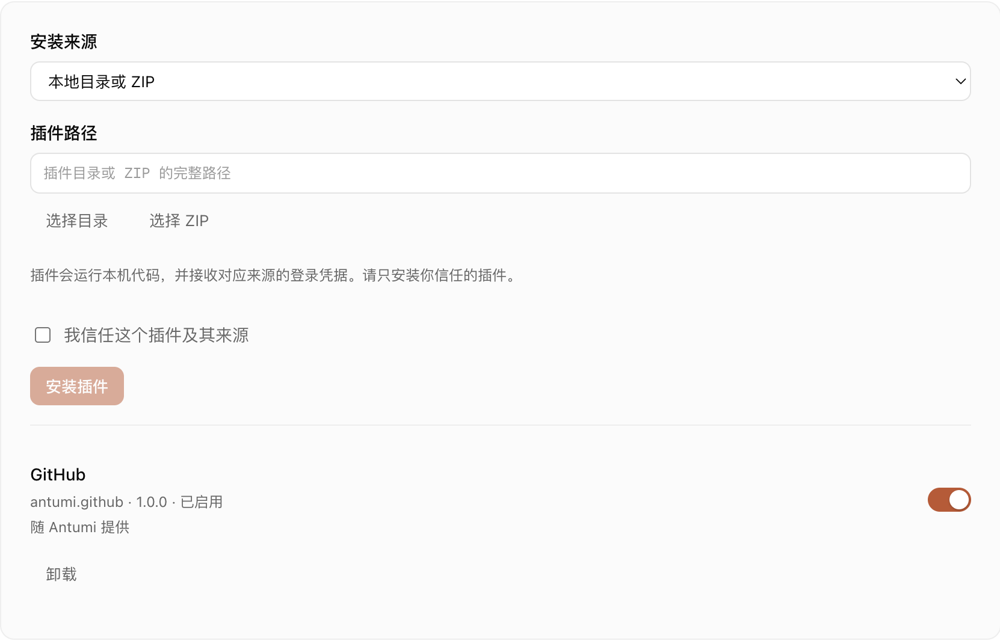
</p>

<details>
<summary><b>还有这些</b></summary>

<br/>

- **待办**：Agent 回复里提到要你之后处理的事会记成待办，标明「需要你」还是「Agent 可做」。换轮、重启、移交都还在，总览里可以勾掉或一键交回给 Agent。
- **多项目任务**：一个任务跨前后端多个仓库，每个仓库各建一个 worktree，分支同名。
- **任务依赖**：前置任务验收通过才放行，新分支直接叠在前置任务的分支上；没放行前也能先规划。
- **分支视图**：检查器里看任务分支从哪里长出来、有几个提交，右键复制 SHA、建分支、打标签或比较。
- **Worktree 清理**：按「能不能清理」分组，删前逐个复查，从不 `--force`，有未提交改动或独有提交的一律保留。
- **终端与端口面板**：shell 由 daemon 托管，关窗口不断；列出每个任务、会话在监听的端口，一键在内置浏览器里打开。
- **Agent 能翻你的记录**：通过 Antumi 的 MCP 读最近的会话、任务和群聊，不管是哪个 Agent 做的，适合「总结我本周的工作」。
- **并发上限**：限制同时运行的 Agent 总数和每款 Agent 的数量，超出的排队。
- **知识库、技能库、MCP**：接入 Obsidian 库作为资料，安装和更新 Agent Skills，统一管理你的 MCP 服务器。

<table>
<tr>
<td width="50%" valign="top">
  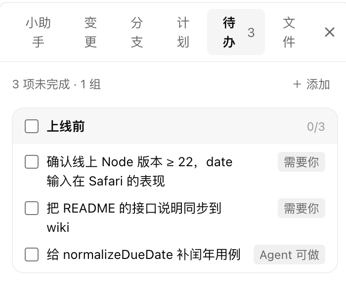<br/>
  <sub>待办：谁来做，一眼分清</sub>
</td>
<td width="50%" valign="top">
  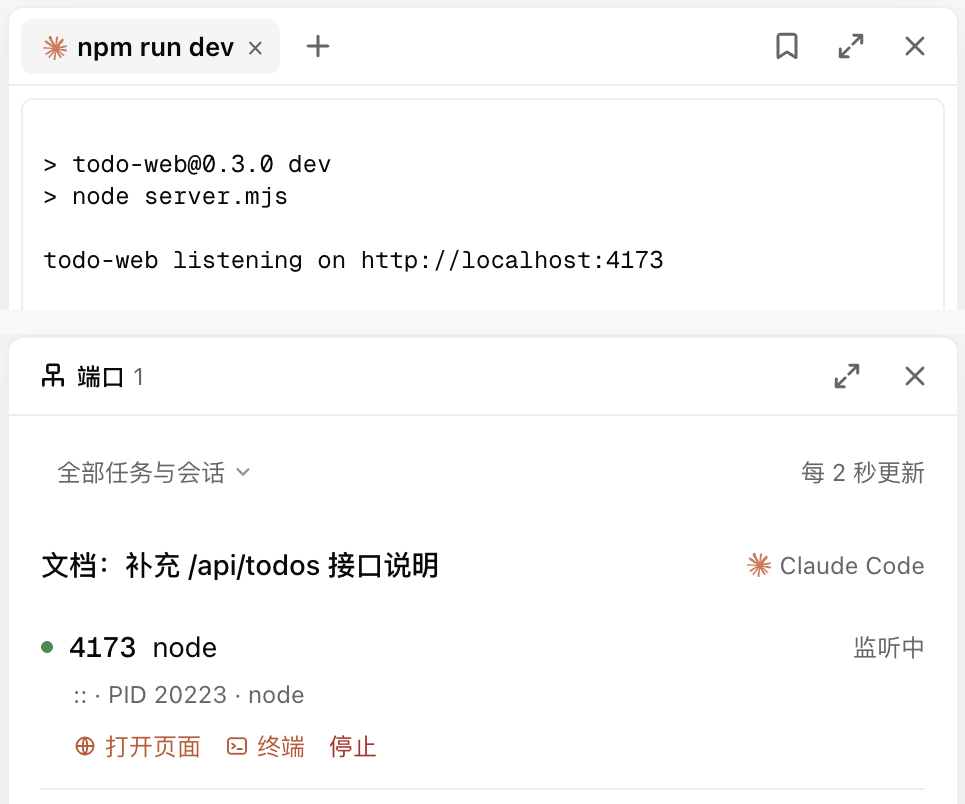<br/>
  <sub>终端与端口：谁在监听哪个端口，一键打开或停掉</sub>
</td>
</tr>
<tr>
<td valign="top">
  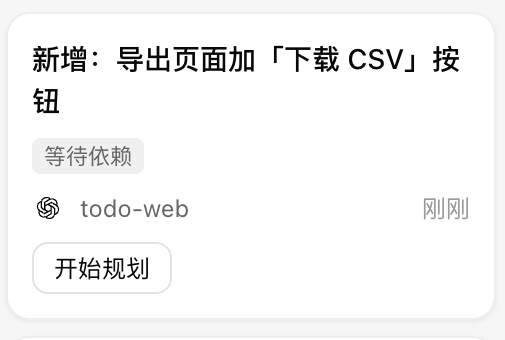<br/>
  <sub>任务依赖：前置任务验收前只能先规划</sub>
</td>
<td valign="top">
  <br/>
  <sub>分支视图：任务分支从哪里长出来</sub>
</td>
</tr>
<tr>
<td valign="top">
  <br/>
  <sub>Worktree 清理：删前逐个复查</sub>
</td>
<td valign="top">
  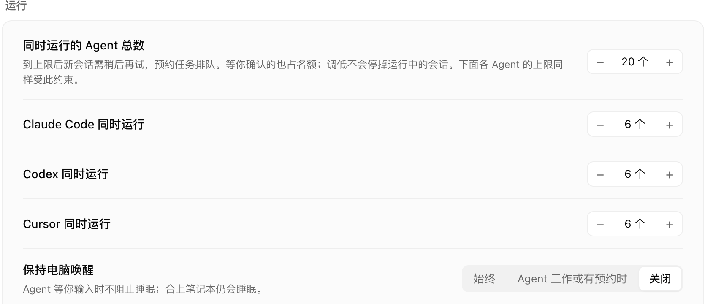<br/>
  <sub>并发上限：总数和每款 Agent 分开限</sub>
</td>
</tr>
<tr>
<td colspan="2" valign="top">
  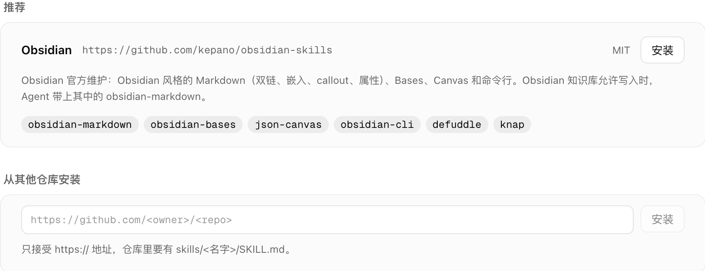<br/>
  <sub>技能库：从 Git 仓库安装 Agent Skills，固定提交、可回退</sub>
</td>
</tr>
</table>

</details>

## 支持的 Agent

Antumi 驱动的是你已经装好、登录好的 Agent CLI。

| Agent | 接入方式 | 权限模式 | 计划审批 | 移交 | 定时 / 预约 |
|---|---|---|:-:|:-:|:-:|
| [**Claude Code**](https://github.com/anthropics/claude-code) | `claude -p`（stream-json） | 逐项确认 · 自动接受编辑 · 规划 · 自动判断 | ✓ | ✓ | ✓ |
| [**Codex**](https://github.com/openai/codex) | `codex app-server` | 逐项确认 · 自动 · 规划 · 只读 | ✓ | ✓ | ✓ |
| [**Cursor**](https://cursor.com/cli) | `cursor-agent acp` | Agent · Plan · Ask | ✓ | ✓ | — |

「全部放行」不会默认选中。设置 → 智能体 还会列出 Antumi 认识、但尚未接入的 Agent CLI。

## 快速开始

**前提**：至少装好并登录一个上面表格里的 Agent CLI。

**从源码运行**，需要 Node ≥ 22.13 和 pnpm 12：

```bash
git clone https://github.com/flyhero/antumi.git
cd antumi
pnpm install
pnpm dev          # 同时启动 daemon、core 和桌面端
```

**打包成 macOS 应用**（Apple Silicon）：

```bash
pnpm dist:mac     # 产物在 packages/desktop/dist/Antumi-<版本>-arm64.dmg
```

装了 App 的机器不需要 Node 和 pnpm。产物没有签名，拷到别的机器上首次要右键「打开」。

<p align="center">
  
</p>

<details>
<summary><b>常用快捷键</b></summary>

<br/>

| 按键 | 作用 |
|---|---|
| <kbd>N</kbd>（看板上） | 在「未执行」列顶部快速记一个任务 |
| <kbd>⌘</kbd> <kbd>N</kbd> | 打开完整的新建任务对话框 |
| <kbd>Ctrl</kbd> <kbd>`</kbd> | 打开 / 关闭终端面板 |
| <kbd>Ctrl</kbd> <kbd>Shift</kbd> <kbd>`</kbd> | 打开 / 关闭浏览器面板 |
| <kbd>⌘</kbd> <kbd>,</kbd> | 设置 |
| <kbd>⌘</kbd> <kbd>F</kbd> | 搜索当前聊天 |
| <kbd>⌘</kbd> <kbd>S</kbd> | 保存检查器里正在编辑的文件 |
| <kbd>Enter</kbd> / <kbd>Shift</kbd> <kbd>Enter</kbd> | 发送 / 换行；Agent 忙时 Enter 会把消息排队 |
| <kbd>Tab</kbd> 或 <kbd>→</kbd> | 采用 Claude Code 预测的下一句 |
| <kbd>Esc</kbd> | 中断当前回合；在任务页里回到看板 |

</details>

## 本地优先，安全优先

- **数据在你的机器上**：任务、会话和 worktree 都在 `~/.antumi/`，核心功能不依赖任何 Antumi 托管服务。
- **只对本机开放**：core 只监听 `127.0.0.1`，并且每个连接都要带 token。
- **不经过 shell**：Agent 命令以参数数组启动，prompt 前加 `--`。
- **凭据不外泄**：Jira / GitHub 凭据单独存放（权限 600），不返回给界面，也不交给 Agent。
- **外部内容当作不可信**：导入的 issue 原文包在 `<untrusted-source>` 里交给 Agent；任务图片保存前去掉 EXIF。
- **不替你删成果**：worktree 只在你确认后清理，删前重新检查，有未提交改动或独有提交的一律保留。

## 文档

| 我想…… | 看这里 |
|---|---|
| 了解整体架构、进程边界和通信协议 | [技术架构 · 总体架构](docs/ARCHITECTURE.md#1-总体架构) |
| 弄清任务怎么流转、规划、验收、处理依赖 | [技术架构 · 任务模型](docs/ARCHITECTURE.md#2-任务模型) |
| 管理 worktree、分支、合并冲突 | [技术架构 · Worktree 与 Git](docs/ARCHITECTURE.md#3-worktree-与-git) |
| 了解各 Agent 怎么接入、权限模式对应什么 | [技术架构 · Agent 接入与聊天](docs/ARCHITECTURE.md#4-agent-接入与聊天) |
| 让 Agent 用浏览器验证页面 | [技术架构 · 内置浏览器](docs/ARCHITECTURE.md#5-内置浏览器) |
| 写一个任务来源插件 | [插件](docs/PLUGINS.md) |
| 打包、安装、卸载 | [技术架构 · 打包与安装](docs/ARCHITECTURE.md#8-打包与安装) |
| 看每个版本改了什么 | [CHANGELOG.md](CHANGELOG.md) |

## 参与开发

先读 [AGENTS.md](AGENTS.md)（进程边界、协议、提交规范）和 [DESIGN.md](DESIGN.md)（视觉规范）。提交前跑：

```bash
pnpm typecheck && pnpm test     # 桌面端改动再加 pnpm build
```

手动试用时别碰自己的真实数据，用测试目录起一套独立实例：

```bash
ANTUMI_HOME=~/.antumi-demo pnpm dev
```

## 现状

Antumi 目前是**开发者预览版**（0.18.x），主要在 macOS 上开发和测试，需要从源码运行或自行打包。接下来按优先级：

- **验收闭环**：在现有提交前检查的基础上，完善检查结果展示以及 PR 与合并流程。
- **Windows**：界面和字体已经适配，差 Agent CLI 的 `.cmd` 启动方式。
- **远程执行**：让 Agent 在 SSH / WSL 里的仓库上干活，看板留在本机。

用下来哪里别扭、想接哪个 Agent，欢迎提 [issue](https://github.com/flyhero/antumi/issues)。

## 关于名字

**Antumi（安图米）是一个受 ant（蚂蚁）启发的自造词。** 单只蚂蚁很小，合力却能完成大活。Antumi 把不同的 AI 编程 Agent 集中到同一个工作台，让任务分头推进，进度和成果都看得清楚。

吉祥物是一只叫「蚁米」的小蚂蚁：App 图标上它抱着三块代表 Agent 的积木，界面里它会在 Agent 干活时搬包裹、等你回答时停下来。

## 许可

[Apache License 2.0](LICENSE)
