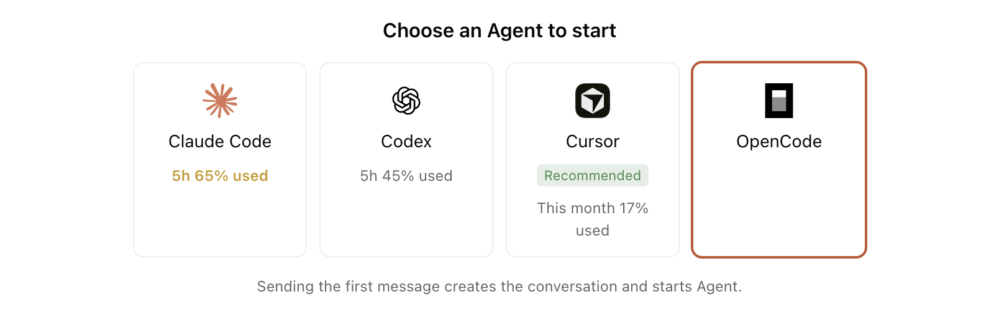
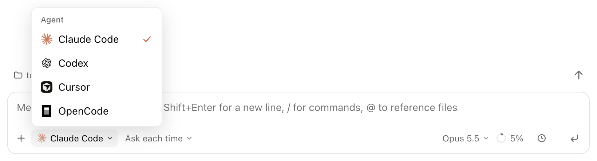
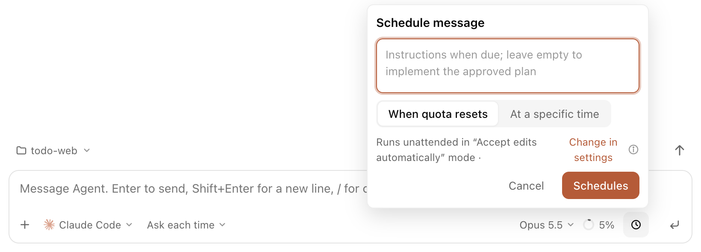
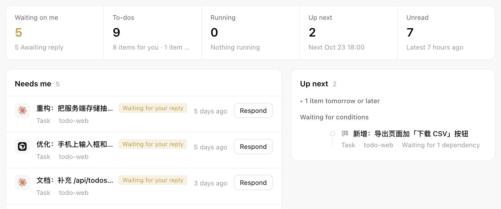
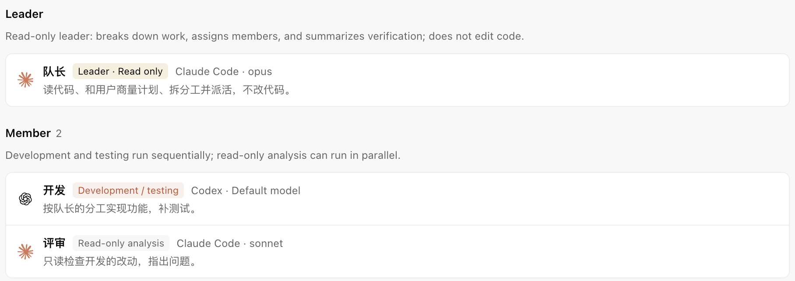
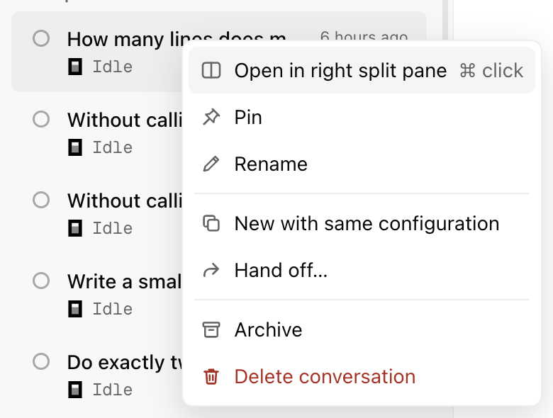
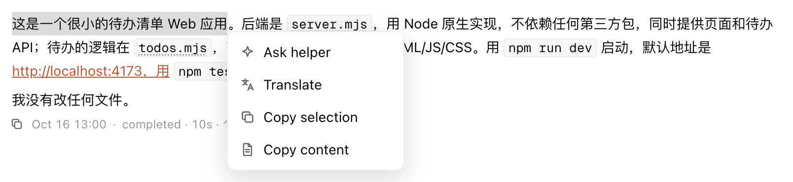
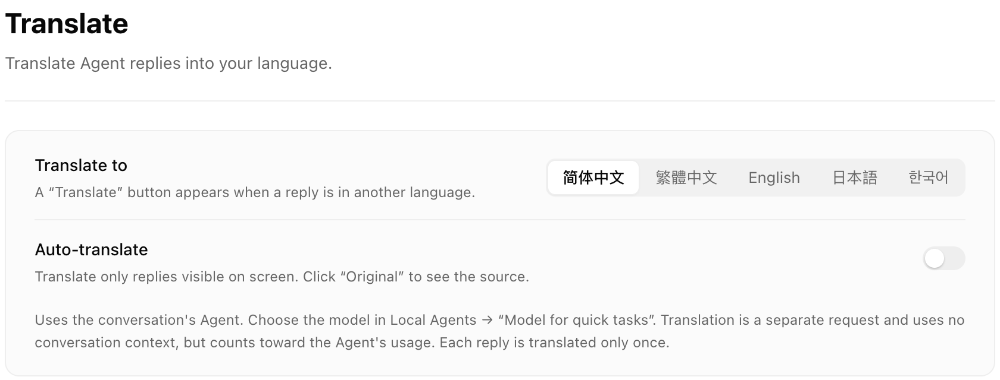

# Welcome to Antumi

Antumi drives the Claude Code, Codex, Cursor and OpenCode you already have, all from one window. Chatting, editing code and approving actions work much as in each agent's own desktop app, so this guide covers only what Antumi adds.

> First make sure at least one agent is installed and signed in: **Settings → Local Agents**.

## Every agent, every quota at a glance

Pick the agent when you start a conversation. The one marked **Recommended** is the one to use now: it has the most quota left, or quota about to reset that would otherwise go unused.

The status bar always shows each agent's usage. Hover to see when it resets; reset cards are used from here too.

## Handoff

Out of quota, or want another agent to carry on? Click the agent's name at the bottom left of the input box, pick another, add a note and click **Hand off**. The new agent gets the chat history and keeps working in the same folder.

## Scheduling: send when quota resets, or at a set time

1. Write your message in the input box.
2. Click the **clock** button at the bottom right of the input box.
3. Choose **When quota resets** or **At a specific time**.
4. Confirm.

| You can also schedule | Where |
|---|---|
| A task | The clock button on the task's toolbar |
| Approving a plan | **Schedule approval** on the plan card |
| View, reschedule or cancel | "N schedules" in the status bar, or **Up next** in the Overview |

When it is due, the agent runs unattended in the mode shown in the popover; **Change in settings** picks another. Nothing runs while the computer sleeps; turn on **Keep computer awake** from the coffee cup in the status bar.

## Overview: everything waiting on you

**Overview**, at the top of the sidebar, gathers every conversation and task: approvals and questions waiting on you, to-dos, work in progress, what comes next, and what you haven't read. Approve right there.

## Squads

Give a lead, developers and a reviewer their own agent, model and duties, then hand a task to the whole squad. The lead agrees a plan with you first, then assigns the work: development runs in sequence, read-only analysis in parallel.

## Split view: two conversations side by side

| To | Do this |
|---|---|
| Open a split | Right-click another conversation → **Open in right split pane**; or ⌘-click it; or drag it onto the chat |
| Move focus | ⌘1 for the left pane, ⌘2 for the right |
| Resize | Drag the divider between them |
| Put away / bring back | ⌘\ |

Each side has its own input, progress and approvals.

## Helper and translation

Select part of a reply and right-click:

- **Ask helper**: opens on the right with a light model and its own context, to explain or dig in without touching the main conversation.
- **Translate**: translates just the selection. When a reply is in another language, a **Translate** button under it translates the whole reply.

| Setting | Where |
|---|---|
| Language to translate into, auto-translate | **Settings → Translate** |
| Model used for translation | **Settings → Local Agents → "Model for quick tasks"** |

## Also worth knowing

| Feature | How |
|---|---|
| To-dos | Agents note what you need to do later; tick them off in the inspector's **To-dos** tab |
| Conversation groups | **Group and sort** on the sidebar's **Conversations**: by project, agent or run status |
| Keeps running | Agents run in a background process; closing the window does not stop them |

You can open this guide again any time from **Settings → About**.
