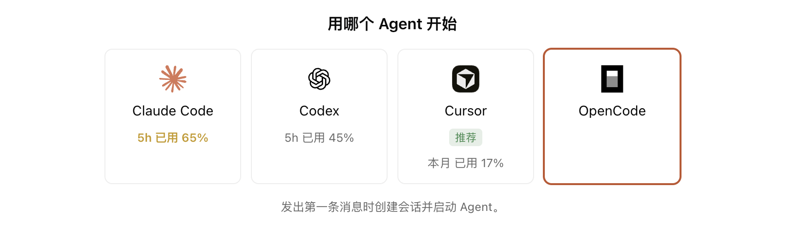
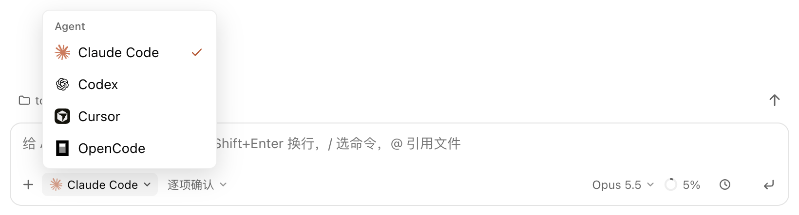
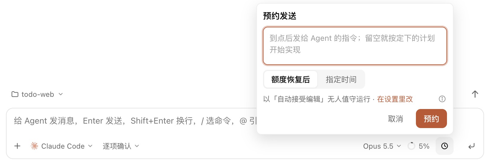
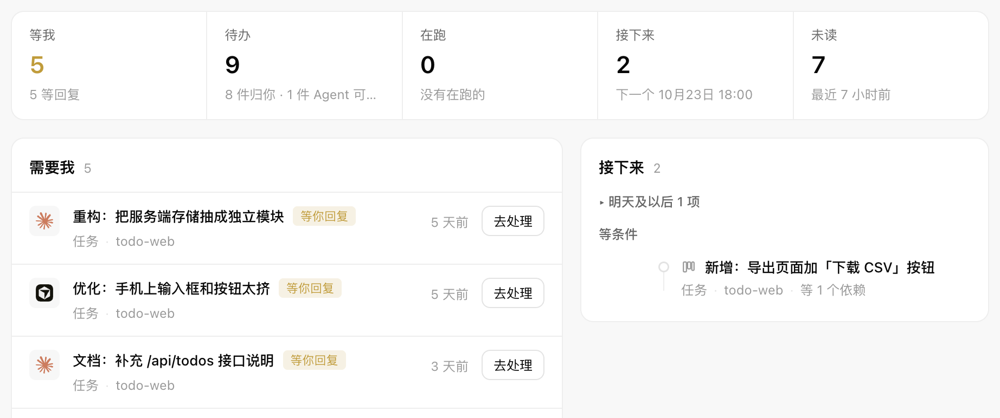
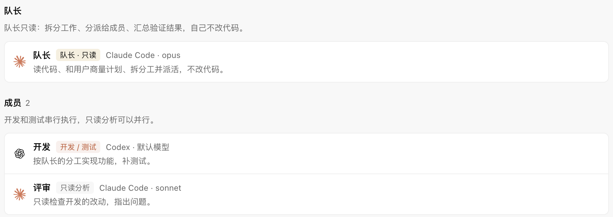
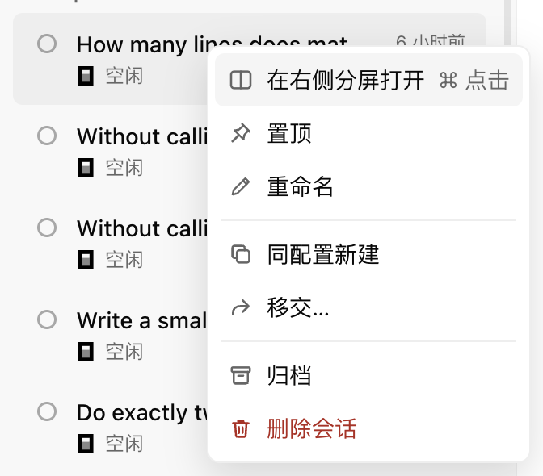
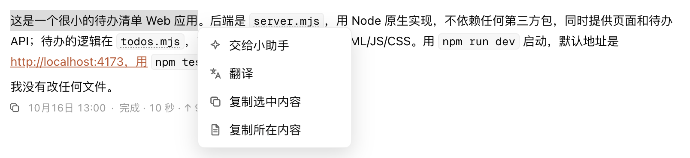
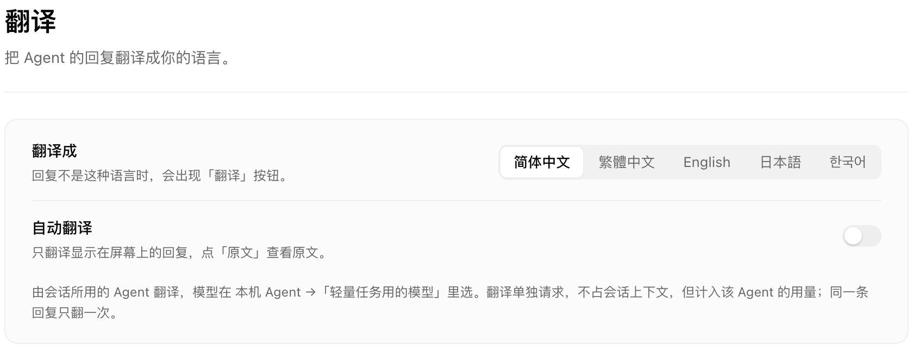

# 欢迎使用 Antumi

Antumi 在一个窗口里驱动你装好的 Claude Code、Codex、Cursor 和 OpenCode。聊天、改代码、批准操作和各家桌面端差不多，这里只讲 Antumi 特有的部分。

> 先确认至少一个 Agent 已安装并登录：**设置 → 本机 Agent**。

## 多个 Agent，额度一眼看清

新建会话时直接挑 Agent。标 **推荐** 的是眼下最该用的那个：额度最宽裕，或者额度快重置了、不用就浪费。

底部状态栏常驻每个 Agent 的用量。悬停可以看恢复时间，重置卡也在这里用。

## 无缝移交

额度用完了，或者想换个 Agent 接着做：点输入框左下角的 Agent 名称，换一个，写句补充说明，点 **移交**。新 Agent 会带着聊天记录，在同一个目录里接着做。

## 预约：额度恢复后或到点再发

1. 在输入框里写好消息。
2. 点输入框右下角的 **时钟** 按钮。
3. 选 **额度恢复后**，或 **指定时间**。
4. 点 **预约**。

| 还能预约 | 在哪里 |
|---|---|
| 任务 | 任务工具栏上的时钟按钮 |
| 计划批准 | 计划卡片上的 **预约批准** |
| 查看、改时间、取消 | 状态栏的「N 个预约」，或总览的「接下来」 |

到点后，Agent 按弹窗里写的模式无人值守运行，点 **在设置里改** 可以换。电脑睡着时预约不会运行，可以打开状态栏咖啡图标的「保持电脑唤醒」。

## 总览：所有等你的事

侧栏最上方的 **总览** 汇总所有会话和任务：等你批准或回答的、待办、在跑的、接下来要做的、未读的。批准可以直接在这里点。

## 研发小队

给队长、开发、评审分别配 Agent、模型和职责，再把任务交给整支小队。队长先和你确认计划，再派活：开发串行进行，只读分析可以并行。

## 分屏：两个会话并排

| 操作 | 方法 |
|---|---|
| 打开分屏 | 右键另一个会话 → **在右侧分屏打开**；或按住 ⌘ 点它；或把它拖到聊天区 |
| 切换焦点 | ⌘1 左侧，⌘2 右侧 |
| 调整宽度 | 拖动中间的分隔线 |
| 收起 / 恢复 | ⌘\ |

两侧可以分别输入、看进度、处理批准。

## 小助手与翻译

选中回复里的一段，右键：

- **交给小助手**：在右侧打开，用轻量模型和独立上下文解释、追问，不占主会话。
- **翻译**：只翻译选中的这段。回复不是你的语言时，回复下方也会出现 **翻译** 按钮，可以翻整条。

| 设置项 | 位置 |
|---|---|
| 翻译成哪种语言、是否自动翻译 | **设置 → 翻译** |
| 翻译用的模型 | **设置 → 本机 Agent →「轻量任务用的模型」** |

## 还有这些

| 功能 | 怎么用 |
|---|---|
| 待办 | Agent 记下要你之后做的事，在检查器的 **待办** 页签里勾掉 |
| 会话分组 | 侧栏 **会话** 的「分组和排序」，按项目、Agent 或运行状态分组 |
| 关窗不停 | Agent 在后台进程里运行，关掉窗口也不打断 |

随时可以在 **设置 → 关于** 里再打开这篇指导。
